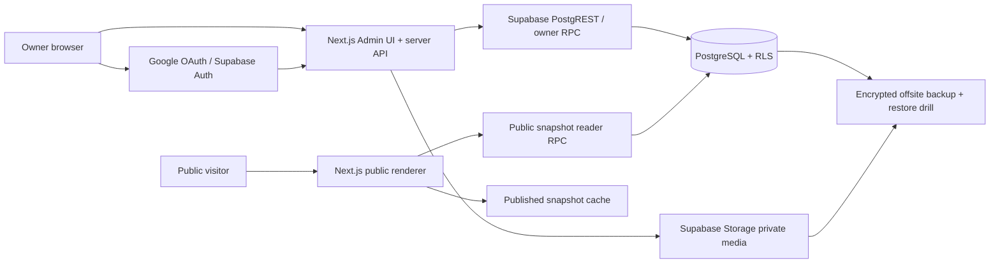

# SRS, Architecture และ Schema สำหรับ Baseline v1.1

สถานะ: ร่างเพื่อให้ Owner ทบทวน, 9 พฤศจิกายน 2569  
อ้างอิง: Project Scope Baseline v1.1 ที่ Owner ส่งในบทสนทนา; ลำดับงานและเกณฑ์รับงานอยู่ใน `docs/ACTION_PLAN_5_PHASES_V1_1.md`

เอกสารนี้ยังไม่อนุญาตให้เปลี่ยน hosted database, เปิด feature flags, Deploy หรือแก้ Production ค่าและกฎที่ยังไม่ตกลงระบุเป็นประเด็นต้องตัดสิน ไม่ถือว่าได้ผ่าน acceptance แล้ว

## SRS: ผู้ใช้และกฎของระบบ

| ID | ข้อกำหนดที่ทดสอบได้ | หลักฐานรับงาน |
| --- | --- | --- |
| AUTH-01 | Google Sign-in ผูก Owner เพียงหนึ่ง Google `sub` กับ Supabase Auth user ที่อนุญาต; การตรวจ Auth UUID อย่างเดียวใน source ปัจจุบันยังไม่พิสูจน์ข้อนี้ | Owner จริงเข้า Admin ได้; Google Non-Owner จริงถูกปฏิเสธหลัง callback; ตรวจ identity binding |
| AUTH-02 | ทุก Admin page, API, RPC, Storage operation ตรวจ Owner ฝั่ง server; RLS ปฏิเสธ Non-Owner และ anonymous | HTTP + direct API tests พร้อม JWT จริงใน test environment |
| AUTH-03 | แอปไม่มีการสมัครสมาชิกสาธารณะหรือ Editor account; Google account อื่นที่ Auth รู้จักไม่รับสิทธิ์ Owner; Owner transfer ต้องมีขั้นตอนที่ตรวจสอบและบันทึก audit | บัญชีอื่นเข้า Admin ไม่ได้; runbook transfer |
| PAGE-01 | ระยะแรกมีหน้าโปรไฟล์ไม่เกิน 10 หน้า, slug ไม่ซ้ำ/ไม่ชน reserved route; โครงสร้างรองรับการขยายในอนาคต | ทดสอบสร้างถึงหน้า 10 และปฏิเสธหน้าที่ 11; slug conflict/reserved tests |
| PAGE-02 | Draft แยกจาก Published; public อ่านเฉพาะ immutable published snapshot | เปลี่ยน draft ไม่เปลี่ยน public response จน Publish ผ่าน |
| PAGE-03 | Public เปิดทั่วไป; Unlisted เปิดได้เมื่อรู้ URL แต่ไม่แสดงในรายการสาธารณะและไม่ตั้งใจส่งเข้า index; public reader ปัจจุบันรองรับเฉพาะ Public | anonymous HTTP, sitemap/robots/meta tests; cache tests |
| PAGE-04 | Archive, Trash และ Restore ได้ภายใน 30 วัน; ต้องตกลงเวลาและวิธีลบถาวรหลังช่วงกู้คืน | state transition, expiry boundary, audit tests |
| PAGE-05 | เปลี่ยน slug แล้ว URL เก่า redirect ไป canonical URL ที่ถูกต้อง | TH/EN redirect, conflict, loop, archived/trashed tests |
| BLOCK-01 | รองรับ Link, Header, Divider, Embed, Image, Text ประมาณ 20 บล็อกต่อหน้า; การมี enum และ snapshot row ใน SQL ยังไม่ใช่ renderer ครบ | renderer และ editor fixture ครบหกชนิด, validation ต่อชนิด |
| BLOCK-02 | เพิ่ม แก้ ลบ duplicate reorder collapse toggle schedule animation ที่เหมาะสม | browser keyboard/drag tests; snapshot order tests |
| BLOCK-03 | Embed รับ URL ของหกแพลตฟอร์มตาม allowlist และไม่รับ HTML/JS อิสระ | valid/invalid URL matrix; CSP/XSS tests |
| TIME-01 | เก็บ schedule เป็น UTC; แก้ไขแสดงเวลา Asia/Bangkok; เวลาเริ่มรวม/เวลาสิ้นสุดไม่รวม | boundary และ timezone tests |
| TIME-02 | หน้าเปิดค้าง re-evaluate schedule; cache fallback ซ่อน scheduled blocks เมื่อ clock ไม่เชื่อถือได้ | browser fake clock และ backend failure tests |
| THEME-01 | Theme config ตรวจ schema, preset และ live preview, รองรับ reduced motion | preset/config/preview tests และ visual review |
| MEDIA-01 | อัปโหลดเฉพาะภาพที่อนุญาต ตรวจ MIME, signature, size, path และ Owner Storage policy | actual Storage HTTP Owner/Non-Owner tests |
| LANG-01 | `/[slug]` เป็นไทย, `/en/[slug]` เป็นอังกฤษ; fallback ไทยเฉพาะช่องที่อังกฤษขาด | route/field-level fallback tests |
| SOCIAL-01 | Social/contact links ตรวจ scheme ต่อชนิดและ icon layout ที่ปลอดภัย | URL validation และ browser tests |
| QR-01 | แต่ละหน้าดาวน์โหลด QR PNG และคัดลอก canonical URL ได้ | decoded QR เท่ากับ URL จริง; clipboard test |
| PUB-01 | Publish/Rollback สร้าง version ใหม่แบบ atomic พร้อม audit; snapshot เดิมแก้ไม่ได้ | stale revision, forced failure และ immutable history tests |
| AUDIT-01 | เก็บเหตุการณ์ login, publish, rollback, deletion, security changes, critical errors 90 วัน | event coverage และ retention job tests |
| BACKUP-01 | สำรองรายสัปดาห์และก่อนเปลี่ยนสำคัญ, เก็บ 4 ชุดนอก Supabase, DB+file bytes, restore ผ่าน | ตรวจ checksum, decrypt, Auth/Storage restore และ re-download bytes |
| PERF-01 | Public p75 LCP ≤2.5s, INP ≤200ms, CLS ≤0.1; แยก third-party embeds | รายงานสภาพทดสอบและ percentile ที่ทำซ้ำได้ |
| A11Y-01 | Public/Admin ใช้ keyboard, screen reader, focus และ reduced motion ได้ | automated checks กับ manual assistive-tech walkthrough |
| OPS-01 | ใช้ Free Tier เท่านั้น; ไม่มี SLA 24/7; เลือก Cloudflare หรือ Netlify หลัง spike | limits/compatibility/cost report และ Owner decision |

ข้อกำหนดเพิ่มเติมก่อน implement: ตกลงว่าจำกัด 10 หน้าจากจำนวน active pages หรือรวม archived/trashed ด้วย และนิยามว่า “ประมาณ 20 บล็อกต่อหน้า” เป็น capacity target หรือ hard limit; retention เมื่อหน้าอยู่ Trash; ความหมายของ “ลบถาวร” ต่อ versions/audit/backup; เวลา cache สดสูงสุด; วิธี public media ที่ไม่ผูก private signed URL ระยะสั้น; ผู้รับผิดชอบ offsite backup

## Architecture: เส้นทางข้อมูลและขอบเขตสิทธิ์

สถาปัตยกรรมเป้าหมายกำหนดให้ Admin browser ไม่ถือ service-role secret ทุก mutation ต้องผ่าน verified Owner session, same-origin check, validation และ transaction ฝั่ง server ก่อนแตะฐานข้อมูล RLS/ACL เป็นชั้นป้องกันอีกชั้นหนึ่ง Anonymous ไม่ได้รับสิทธิ์ SELECT ตาราง draft, versions, audit หรือ owner config เมื่อทำครบตาม Baseline public RPC ต้องคืนเฉพาะ published data โดยกรอง visibility, active state, schedule และ locale ก่อนส่งออก ปัจจุบัน RPC ส่ง profile text และ active links ของหน้า Public เท่านั้น

Publish transaction ตรวจ Owner, expected draft revision, page state และ release switch ในฐานข้อมูล แล้วสร้าง immutable snapshot, version และ audit ก่อนเปลี่ยน pointer แบบ atomic หากขั้นตอนไหนล้มเหลวต้อง rollback ทั้งชุด Rollback ใช้ snapshot เก่าเป็นต้นทางของ version ใหม่ ไม่แก้ version เดิม

Public snapshot cache ต้องผูก key กับ version, slug, locale และ visibility การเปลี่ยน Publish/Archive/Trash/slug ต้อง invalidate หรือเลิกใช้ key เก่า กำหนด TTL และ fallback ให้ชัดใน SRS สำหรับ schedule ต้องตรวจเวลาใหม่เมื่อแสดงผล และซ่อนเมื่อ clock ไม่เชื่อถือได้ ห้าม cache ทำให้ Unlisted กลายเป็นรายการค้นพบโดยไม่ตั้งใจ

Media มีสองกรณีต่างกัน: Owner จัดการไฟล์ใน private Storage ผ่าน signed URL อายุสั้น; ภาพที่อยู่ใน published public snapshot ต้องมี delivery policy ที่อ่านได้ตาม visibility โดยไม่เปิด private bucket ทั้งหมด ต้องกำหนด policy ก่อนทำ Public Image block

Google OAuth, Supabase service, hosted runtime และ offsite backup เป็นขอบเขตภายนอกที่ CI จำลองได้ไม่ครบ จึงต้องมี acceptance บน isolated Test ที่ได้รับอนุญาตแยก ก่อนใช้ผลนั้นรับรอง Production

## Schema: เป้าหมายและ gap จาก migrations 0001–0009

| Entity | อยู่ใน migration ปัจจุบัน | สิ่งที่ต้องนิยามหรือเพิ่ม |
| --- | --- | --- |
| `owner_config` | Auth user UUID เดียว, Owner RLS helper | Google `sub` binding/transfer procedure และ audit โดยไม่เผย identity |
| `pages` | slug, visibility, status, published pointer, deleted_at | transition rules, 30-day trash expiry, quota policy, canonical locale URL |
| `page_drafts` | profile/theme/social JSON, revision | versioned typed contract, bilingual fields, block draft ownership, autosave CAS |
| `page_blocks` | six type enum, sort, active, animation, schedule, deleted_at | typed content schema, translations, duplicate/reorder atomicity และ tombstone semantics |
| `page_versions` | immutable version snapshot, parent link | snapshot schema version, theme/social/blocks/locale/visibility capture |
| `slug_history` | old slug unique, page link | redirect policy for TH/EN, reserved/conflict/loop handling |
| `media_assets` | page, storage path, MIME, size, deleted_at | ownership/refcounts, image derivatives, publication access, cleanup policy |
| `audit_events` | actor/event/metadata/time | required event taxonomy, 90-day retention, tamper limits, sensitive-data redaction |
| `backup_manifests` | reference/checksum/verified time | four-copy retention, offsite status, restore proof and bytes manifest |
| `app_private.release_settings` | private publish/public read switches default OFF | approved rollout state and verifiable switch control |

ข้อเสนอการออกแบบ: ให้ JSON contract มี schema version และ validator ฝั่ง server สำหรับ `profile`, `theme`, `socials`, `block.content` และ `snapshot` เก็บคำแปลแยกตาม field เพื่อให้ fallback ภาษาไทยได้เฉพาะช่องที่ขาด Owner ต้องทบทวนรูปแบบนี้ก่อนออก migration

ข้อมูล Draft และ Published ต้องมี ownership ชัดเจน `page_blocks` ปัจจุบันมี schema และ `0006_immutable_publish_core.sql` ใส่ block rows ลง immutable snapshot แล้ว แต่ Owner API ยังแก้ `profile_json.links` เป็นหลัก และ `0007_staged_publication.sql` public reader คืนเฉพาะ profile text กับ active links จึงยังไม่มี flow จัดการและแสดงผลหกบล็อกครบ ต้องตกลง contract/transaction และทดสอบบนฐานข้อมูลแยกก่อนออก migration เพิ่ม

## ความสัมพันธ์กับหลักฐานปัจจุบัน

- `docs/PHASE2_RELEASE_GATES.md` ระบุ CI ที่ผ่านสำหรับ Auth, RLS, Storage, Next.js HTTP, draft และ staged publication พร้อม gate ที่ยังเปิด
- `src/app/[slug]/page.tsx` แสดงเพียง profile text กับ Link; `src/lib/domain/rules.mjs` มี schedule logic ที่ยังไม่ต่อ renderer
- `src/lib/domain/draft-contract.mjs` จำกัด draft ปัจจุบันเป็น profile + ไม่เกิน 20 Link entries; ยังไม่ใช่ six-block/bilingual contract
- `supabase/migrations/0001_initial_schema.sql` วางตารางเป้าหมายหลายรายการ แต่มี schema ไม่เท่ากับ feature ทำงานครบ
- `docs/HOSTING_SPIKE.md` เลือก Cloudflare ในแผนเดิม; Baseline v1.1 กำหนดให้เปรียบเทียบ Cloudflare กับ Netlify Free ก่อนตัดสิน

## การตรวจรับเอกสาร

Owner ต้องยืนยัน requirement ที่ยังเปิด, public/unlisted behavior, ขอบเขตการใช้ cache และ media, hard limits, backup destination และ hosting criteria จากนั้นจึงแปลงตาราง ID ด้านบนเป็น issue/acceptance suite ที่ผูกกับ commit ได้ สำหรับขั้น implementation ยังต้องมีคำสั่งแยกตามหัวข้อ 19 ของ Baseline และข้อห้ามเดิม
